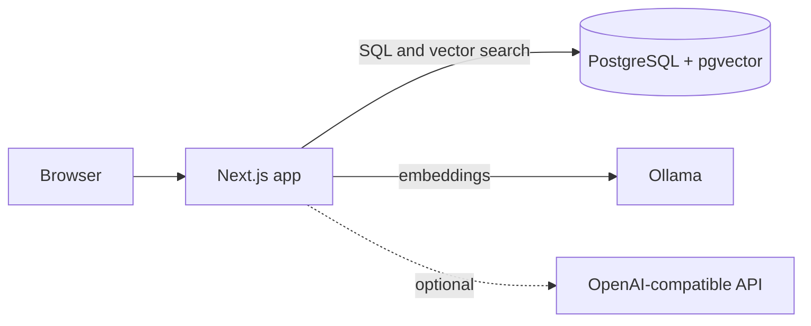

<div align="center">

# Atlas Index

**A private, offline-first knowledge base with semantic search.**

Store Markdown notes and documents, index them with vector embeddings, and
retrieve them by meaning. Runs entirely on your own machine via Docker Compose.

[](https://github.com/oar06g/Atlas-Index/actions/workflows/ci.yml)
[](LICENSE)
[](https://nextjs.org)
[](https://www.postgresql.org)
[](https://github.com/oar06g/Atlas-Index/pkgs/container/atlas-index)

</div>

## Overview

Atlas Index combines a Next.js web interface, PostgreSQL with pgvector, and a
local embedding model served by Ollama. Entries are chunked and embedded in the
background; searches are answered by cosine similarity over those embeddings,
with PostgreSQL full-text search as a complementary and fallback path. No cloud
account is required, and your content never leaves the host.

## Features

- **Semantic search** over chunked entry content, merged with PostgreSQL
  full-text ranking.
- **Markdown authoring** with live preview, syntax highlighting, categories and
  tags.
- **Background indexing queue** with per-entry progress, failure details and
  one-click retry; interrupted jobs resume after a restart.
- **Provider-agnostic embeddings** — Ollama, OpenAI, or any OpenAI-compatible
  endpoint, configurable at runtime from the Settings page.
- **Single-command deployment** with Docker Compose and a published container
  image on GHCR.
- **Service health reporting** through `/api/status` and the in-app status panel.

## Architecture

| Service | Image | Responsibility |
| --- | --- | --- |
| **app** | `ghcr.io/oar06g/atlas-index` | Next.js 16 web UI and API (`:3000`) |
| **db** | `pgvector/pgvector:pg17` | PostgreSQL 17 + pgvector: entries, chunks, embeddings, settings (`:5432`) |
| **ollama** | `ollama/ollama` | Local embedding model server (`:11434`) |



An entry is saved immediately with `status = pending`, split into 1,200-character
chunks with 200-character overlap, embedded in small batches, and stored with the
`model_id` that produced each vector. Search only considers chunks from the
model currently configured, so entries must be re-indexed after a model change.
The schema is embedded in [`compose.yml`](compose.yml) so the file works on its
own, and mirrored in [`queries/init.sql`](queries/init.sql) for manual use.

## Quick start

Requires Docker with Compose v2.23.1+ and roughly 2 GB of free disk space.

### Run the published image

The Compose file embeds the database schema and the Ollama bootstrap script, so
it can run on its own without cloning the repository:

```bash
mkdir atlas-index
cd atlas-index
curl -fsSLO https://raw.githubusercontent.com/oar06g/Atlas-Index/main/compose.yml
docker compose up -d
```

### Build from source

```bash
git clone https://github.com/oar06g/Atlas-Index.git
cd Atlas-Index
cp .env.example .env        # optional; defaults are built in
docker compose -f compose.yml -f compose.build.yml up --build
```

Open <http://localhost:3000>. The first launch pulls the `nomic-embed-text`
model (~274 MB), so it can take a few minutes.

### Prebuilt image

Images are published to the GitHub Container Registry:

```bash
docker pull ghcr.io/oar06g/atlas-index:latest
```

| Tag | Source |
| --- | --- |
| `latest` | Latest commit on the default branch |
| `main` | Current default branch |
| `vX.Y.Z`, `X.Y` | Git version tags |
| `sha-<commit>` | Every published commit |

> Package visibility is set once by the maintainer under the repository's package
> settings. It must be **Public** for anonymous `docker pull` to work.

The default `compose.yml` already uses `ghcr.io/oar06g/atlas-index:latest`, and
it embeds the database schema and Ollama startup script, so the raw file is
self-contained. To pin a specific tag, set it in `.env`:

```bash
# .env
ATLAS_IMAGE=ghcr.io/oar06g/atlas-index:v1.0.0

# start or update the stack
docker compose up -d
```

## Configuration

All environment variables are optional; see [`.env.example`](.env.example).

| Variable | Default | Description |
| --- | --- | --- |
| `DATABASE_URL` | derived from `POSTGRES_*` | Full connection string; overrides individual values |
| `POSTGRES_USER` / `POSTGRES_PASSWORD` | `atlas` | Database credentials |
| `POSTGRES_DB` | `atlasdb` | Database name |
| `POSTGRES_HOST` / `POSTGRES_PORT` | `db` / `5432` | Database address |
| `OLLAMA_MODEL` | `nomic-embed-text` | Model pulled by the `ollama` service |
| `OLLAMA_KEEP_ALIVE` | `24h` | How long the model stays loaded |
| `EMBED_BATCH_SIZE` | `4` | Chunks per embedding request |
| `EMBED_TIMEOUT_MS` | `120000` | Request timeout; failed batches are retried and split |
| `NEXT_PUBLIC_APP_URL` | `http://localhost:3000` | Public application URL |
| `ATLAS_IMAGE` | `ghcr.io/oar06g/atlas-index:latest` | Application image; pin a tag or use a local build |

The active embedding provider, model, dimensions and API key are stored in the
`settings` table and edited at `/settings`. Dimensions must match the model
output (768 for `nomic-embed-text`, 384 for `all-minilm`); use **Test model** to
validate a configuration before saving.

Atlas Index has no built-in authentication. Run it on a trusted network and place
it behind an authenticated reverse proxy if remote access is required.

## Development

```bash
npm install
docker compose up -d db ollama
npm run dev
```

Outside Compose the app connects to `localhost:5432` and `localhost:11434`.
Apply the schema once on a fresh database:

```bash
docker compose exec -T db psql -U atlas -d atlasdb \
  -f /docker-entrypoint-initdb.d/10-init.sql
```

| Command | Description |
| --- | --- |
| `npm run dev` | Development server |
| `npm run build` | Production build |
| `npm run start` | Serve the production build |
| `npm run lint` | ESLint |
| `npm run seed` | Seed the sample technical corpus (idempotent) |

`npm run seed` connects directly to the database, embeds the sample entries with
the model in Settings, and inserts them in one transaction. It skips entries
whose title or slug already exists. Use `npm run seed -- --dry-run` to preview,
or `npm run seed -- --limit=10` to try a smaller batch.

## API

| Method | Endpoint | Description |
| --- | --- | --- |
| `GET` | `/api/status` | Database and embedding health |
| `GET` | `/api/entries?status=&limit=` | List entries by status |
| `GET` | `/api/entries/{slug}` | Fetch an entry and its indexing progress |
| `POST` | `/api/entries/create-entry` | Create an entry and queue it for indexing |
| `POST` | `/api/entries/generate-embedding` | Re-index an entry (`entryId`) |
| `POST` | `/api/search` | Semantic and full-text search (`query`) |
| `GET` | `/api/categories` | List categories |
| `POST` | `/api/create-category` | Create a category |
| `GET` | `/api/settings` | Read embedding settings |
| `POST` | `/api/settings` | Update embedding settings |
| `POST` | `/api/settings/test` | Test an embedding configuration |

## Contributing

Read [`CONTRIBUTING.md`](CONTRIBUTING.md) before starting. Open an issue, wait
for approval, branch as `issuenumber-typeofissue-branchname`, and reference the
issue in your pull request. Ensure `npm run lint` and `npm run build` pass.

## License

Released under the [Apache License 2.0](LICENSE).
